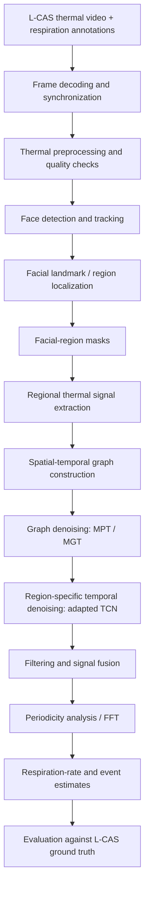

# Thermal Face Detection and Facial Region Segmentation for Indirect Breathing Monitoring

> **Project focus:** Detect and track a face in thermal video, segment candidate facial regions, extract thermal-temperature signals, and estimate respiration activity without attaching a sensor to the subject. ROS `mono16` values are retained, with Celsius values derived using the conversion documented by L-CAS.
>
> **Dataset:** L-CAS Thermal Physiological Monitoring Dataset  
> **Primary target:** Respiration / breathing rate (RR)  
> **Input modality:** Thermal video only

## 1. Project overview

This project proposes a thermal-video-based pipeline for indirect respiration monitoring. It combines ideas from three research papers:

1. **Facial-region extraction and temperature measurement** — image enhancement, facial localization, landmark-guided region allocation, and regional temperature measurement.
2. **Graph-based denoising for respiration estimation in thermal video** — multiple signals from facial subregions, spatial–temporal graph filtering, Butterworth filtering, PCA, and FFT-based periodicity analysis.
3. **AND-rPPG temporal denoising** — region-specific Temporal Convolutional Networks (TCNs), dilated temporal convolutions, and skip connections to suppress region-dependent noise.

The proposed integration adapts these ideas to the L-CAS thermal-only dataset. It does **not** perform identity recognition. The term *face detection* is used to mean locating the face, while *facial-region segmentation* means separating the face into anatomical regions useful for respiration analysis.

The combined framework is a research proposal to be implemented and evaluated. Its performance has not yet been established on L-CAS.

## 2. Research objectives

- Detect and track the subject's face in thermal frames, including recordings with controlled head movement.
- Segment facial regions consistently across frames.
- Extract a separate raw thermal-count time series from each region.
- Reduce spatial, temporal, acquisition, and motion-related noise.
- Estimate respiration rate and/or breathing-event timing from the denoised signal.
- Evaluate the estimates against the respiration annotations supplied with L-CAS.

### Research questions

1. Does anatomical facial-region segmentation provide more useful respiration signals than a single large face ROI?
2. Does graph-based spatial–temporal denoising improve the regional signals?
3. Does an additional region-specific TCN improve results over graph filtering alone?
4. How robust is the complete pipeline when the subject moves their head?

## 3. Dataset: L-CAS

The project uses the L-CAS Thermal Physiological Monitoring Dataset. The workspace contains extracted thermal PNG sequences, five original ROS1 thermal bags under `ros/`, and physiological reference CSVs.

| Property | Dataset information / current inspection |
|---|---|
| Modality | Extracted thermal PNG frame sequences plus physiological reference CSVs |
| Image dimensions | `288 × 382` pixels |
| Pixel representation | PNG frames are 8-bit replicated grayscale; ROS bags contain original `mono16` sensor matrices (382 × 288) |
| Image count | 14,154 frames across five subject folders: Anestis 2,863; Claudio 2,903; Jaime 2,652; Joao 3,036; Manuel 2,700 |
| Recording duration | Approximately 2 minutes; bag image-header timestamps recovered for each frame |
| Frame/reference counts | Bag image-message counts match all PNG counts exactly. Four subjects also have equal respiration-row counts; Anestis has 2,863 images and 3,526 respiration samples |
| Respiration reference | Manually annotated inhale instants; project-owner-confirmed working mapping: 0=no event, 1=inhalation, 2=exhalation |
| Heart-rate reference | Fingertip pulse-oximeter measurements (not the main target of this project) |
| Recording conditions | Static period and controlled head movements are included in the dataset protocol |

The original L-CAS paper reports 27 Hz and says respiration references were made by manually marking inhalation instants. The official dataset page also lists the camera as 10 Hz. Bag image-header timestamps resolve local image timing: median frame intervals are about 37–38 ms, with irregular gaps and effective whole-recording rates from 21.8 to 24.9 Hz. Four image/reference pairs have equal row counts and same-index timestamps agree within a median absolute difference of 0.5–0.6 ms (maximum 7.9–16.2 ms). Anestis has 2,863 images versus 3,526 reference samples; its first image is about 90 ms before the first respiration sample, so ordinal row pairing is invalid. Source timestamps are timezone-naive; interpreting them as UTC produces the observed sub-frame agreement with ROS Unix timestamps. The project-owner-confirmed working mapping is `0 = no event`, `1 = inhalation`, `2 = exhalation`. Code `1` occurs sparsely at roughly 18–22 events per minute across the five recordings, consistent with the paper's description of inhalation annotations. Joao alone has 37 code-`2` rows, alternating with code `1`. The dataset authors' codebook was not found, so the mapping is a project convention rather than an author-verified definition. See `scripts/audit_respiration_annotation_codes.py` and its generated reports. Raw codes are retained alongside mapped labels; the spectral baseline does not use these codes for formal accuracy evaluation.

**Important:** L-CAS provides respiration event annotations, not necessarily a continuous, clean respiration waveform suitable as a direct target for waveform-reconstruction training. The annotation format must be inspected before selecting a supervised-learning loss.

## 4. Integrated system architecture



### Stage 1 — Thermal frame preprocessing

**Inspired by:** Paper 1, *Extracting Facial Skin Information for Temperature Measurement Using RGB-Thermal Image*.

1. Preserve the PNG sequence and use the original ROS bags to recover sensor timestamps and raw thermal matrices. The bag matrices are `mono16`; the PNGs are correlated 8-bit conversions and remain useful for visualization and the existing face tracker.
2. Inspect invalid pixels, display artefacts, contrast, and frame quality.
3. Create a processing copy for visualization and face localization. Apply enhancement or normalization only where it improves detection or segmentation.
4. Keep source PNGs unchanged and use them for visualization and face localization. Preserve raw sensor counts and derive Celsius values with the official L-CAS encoding formula for thermal-signal experiments.

> **Measurement safeguard:** The PNGs are 8-bit grayscale conversions, not temperature data. The ROS bags provide original `mono16` counts, which are preserved. The L-CAS dataset page documents the encoding conversion `temperature_c = (count - 1000) / 10`; the ROI extractor now writes both counts and Celsius values using this formula. This is the dataset's documented encoding conversion, not a new sensor calibration.

### Stage 2 — Face detection and tracking

**Inspired by:** Paper 2, *Graph-Based Denoising for Respiration and Heart Rate Estimation During Sleep in Thermal Video*, and Paper 1.

- Detect the head/face in an initial frame.
- Establish a face bounding box or head ROI.
- Track the ROI through subsequent frames.
- Re-detect or correct the ROI when tracking confidence falls or the subject moves substantially.
- Record a confidence/validity score for each frame so unreliable frames can be excluded or down-weighted.

Paper 2 uses scale-invariant Chamfer matching with binary head templates and a 2-D tracker. Paper 1 describes landmark-guided facial allocation. These are reference approaches, not a requirement to use the exact same detector. The implementation should compare a practical detector/tracker with the available thermal-image constraints.

The current baseline in `scripts/detect_track_regions.py` uses OpenCV Haar cascades with Lucas-Kanade optical flow between periodic detections. It creates a face box for each available frame and records the tracking method. The heuristic flow score is not a calibrated probability, and full box coverage is not a measured detection-accuracy result. I added configurable `--min-neighbors` and `--scale-factor` parameters and ran an isolated lower-threshold candidate (`2`, `1.05`) across all recordings. It corrects Jaime's initial box but has displaced/incomplete boxes in reviewed head-turn frames, misses eight Anestis frames, and shifts three subjects' nose spectral rates. The completed 20-frame owner reference sample contains 115 visible face and facial-region boxes. Face-only mean IoU is 0.561 for the baseline, 0.535 for `min_neighbors=2`, and 0.569 for `scale_factor=1.05, min_neighbors=2`; across all visible boxes the means are 0.218, 0.206, and 0.220. These single-annotator results are preliminary and do not select a tracker. ROI geometry leave-one-subject-out comparison improves mean IoU from 0.387 to 0.416 with annotated face boxes, but drops from 0.145 to 0.087 with baseline tracker boxes; tracker localization remains a limiting factor. See `data/annotations/owner_tracker_variant_comparison.json`, `data/annotations/roi_geometry_loso_comparison.json`, `data/processed/face_tracking_report.json`, the variant outputs, and the preview overlays.

### Stage 3 — Facial-region segmentation

**Inspired by:** Paper 1, with region-specific processing motivation from Paper 3.

Create masks for candidate facial regions, initially:

- Nose / perinasal region
- Mouth / upper-lip region
- Left cheek
- Right cheek
- Forehead

The forehead and cheek regions follow the facial measurement-region concept in Paper 1. The nose and mouth are additional candidate regions for this respiration-focused project and must be validated experimentally; they should not be assumed to be the best regions in advance.

Possible implementation strategies:

1. Landmark-guided geometric masks as an interpretable baseline.
2. A trained segmentation model (for example, U-Net) if enough manually annotated thermal frames can be prepared.

The dataset does not automatically provide pixel-wise facial-region masks. If a learned segmentation model is used, create and document a manually annotated subset, then split annotations by subject/recording to avoid leakage.

Evaluate segmentation with Dice coefficient and Intersection over Union (IoU), provided reference masks are available.

The current baseline uses geometric candidate rectangles relative to the detected face box. These are exported for forehead, nose, mouth, and both cheeks, with preview overlays under `data/processed/face_previews/`. A visual spot-check of the first-frame overlays across all five subjects shows a notably undersized face box for Jaime that misses much of the visible face; this confirms the need for geometry correction, not a validated detector result. No subject has landmark- or mask-validated ROIs.

### Stage 4 — Regional thermal signal extraction

For each region and frame, calculate regional statistics from the recovered raw `mono16` matrix. Preserve raw count statistics and derive Celsius values with `temperature_c = (count - 1000) / 10`, as documented by the [official L-CAS dataset page](https://lcas.lincoln.ac.uk/wp/research/data-sets-software/lcas-thermal-physiological-monitoring-dataset/). The count matrices remain unchanged; the original PNG intensities remain available for visualization and comparison.

For region `r` at time `t`:

\[
S_r(t) = \frac{1}{|R_r(t)|} \sum_{(x,y)\in R_r(t)} I_t(x,y)
\]

where:

- `I_t(x, y)` is the recovered `mono16` value converted with `(count - 1000) / 10` to degrees Celsius at pixel `(x, y)` in frame `t`.
- `R_r(t)` is the valid pixel mask for region `r` at time `t`.
- `S_r(t)` is the regional mean temperature in degrees Celsius; raw counts are preserved alongside it.

`scripts/extract_roi_signals.py` exports PNG-derived signals to `data/processed/roi_signals.csv`. `scripts/extract_raw_roi_signals.py` applies the same PNG-derived region rectangles to corresponding raw ROS matrices and writes `data/processed/roi_signals_raw_mono16.csv` with raw-count and Celsius statistics plus exact image-header timestamps. The PNG and bag counts match for every subject; sampled first, middle, and last raw/PNG frame pairs have pixel correlations above 0.99998. `scripts/plot_timestamped_roi_signals.py` plots the raw regions and filtered nose signal against seconds. Respiration labels follow the project-owner-confirmed working mapping recorded in the code audit.

`scripts/plot_roi_signals.py` generates per-subject plots under `data/processed/roi_signal_plots/`. They show image intensity against frame index and a 27-frame moving mean; the x-axis is not time in seconds.

`scripts/estimate_respiration_baseline.py` implements the conventional baseline with explicitly configured sampling settings. For the recovered thermal-temperature path, `scripts/estimate_rosbag_timestamp_baseline.py` uses measured image-header timestamps, resamples irregular observations to a uniform grid, applies a fourth-order zero-phase Butterworth filter, and finds a Hann-periodogram peak in the official ROS node default 10–40 BPM search range. It writes results under `data/processed/respiration_baseline_rosbag_raw/`. Current nose-region estimates are 19.23 BPM (Anestis), 12.74 (Claudio), 16.79 (Jaime), 14.27 (Joao), and 11.79 (Manuel). These whole-recording estimates are unvalidated; the tracker and ROIs are not landmark-validated, no motion rejection is applied, and the baseline does not evaluate annotation labels.

`scripts/compare_provisional_code1_event_rates.py` compares those rates with inhalation-event intervals under the project-owner-confirmed working map. It writes `data/processed/provisional_code1_event_rate_comparison.csv` and `.json`. This is a descriptive rate check only: the numeric mapping is not in an author-published codebook and the spectral peak is not event-level validation.

`scripts/compare_phase_specific_respiration_rates.py` compares 60-second thermal spectral estimates with inhalation-interval rates in the protocol's static and head-movement phases. The current event-span-rate mean absolute differences are 4.13 BPM for the static minute and 6.59 BPM for the movement minute; thermal estimates fall below the annotation rates in all ten windows. These results are descriptive only. The known tracker errors may affect the movement windows, and the metric is phase-window rate agreement rather than event-by-event accuracy.

`scripts/evaluate_graph_leave_one_subject_out.py` tunes PWS and converged GTV strengths on four subjects in each fold, then reports the fifth subject once. Held-out mean absolute error is 4.72 BPM for raw signals, 4.62 BPM for selected PWS, and 4.91 BPM for selected GTV. The PWS gain is small and does not establish an improvement with five subjects and unvalidated ROIs; no final graph setting is selected. Results are stored under `data/processed/graph_denoising_rosbag_raw/leave_one_subject_out_tuning.*`.

`scripts/train_tcn_inhalation_event_detector.py` implements the available-label TCN adaptation: sparse inhalation timestamps become Gaussian event targets, and a residual dilated TCN predicts event probabilities from raw/PWS/GTV nose signals. Outer leave-one-subject-out folds use inner subject-wise validation for the probability threshold. The TCN macro F1 is 0.141, below a bandpass peak/valley comparator at 0.318, so it is not selected. This is event detection rather than the continuous-waveform TCN denoising in the reference workflow; no continuous ground-truth respiration waveform is supplied.

Two follow-up evaluations close the component-level ablation work possible with the current five recordings. `scripts/evaluate_event_interval_rates.py` turns held-out event predictions into count, event-span, and median-interval respiration rates. The peak/valley comparator has lower event-span rate MAE (1.53 BPM) than the TCN (13.42 BPM); its event F1 is also higher (0.318 vs. 0.141). `scripts/evaluate_region_graph_ablations.py` evaluates all five candidate ROIs with raw, PWS, and GTV signals (75 subject/region/method rows). Mouth/raw has the lowest exploratory event-span-rate MAE at 2.51 BPM; the graph variants do not change that result. These are fixed-configuration, five-subject comparisons under the working label map, not independent ROI validation or evidence to select a production region. The reports are under `data/processed/tcn_inhalation_event_detector/` and `data/processed/region_graph_ablations/`.

`scripts/audit_timestamped_roi_quality.py` measures face-box center speed, face-box area changes, and consecutive raw nose-signal jumps using the recovered timestamps. It writes per-frame metrics, within-subject 99th-percentile outlier flags, and plots to `data/processed/roi_quality_audit/`. I reviewed the plots for all five recordings: the largest face-motion spikes occur around 60–82 seconds, and the strongest nose jumps occur around Anestis 85 s, Claudio 82 s, Jaime 62/71 s, João 90–101 s, and Manuel 92 s. Each recording has roughly 40–50 motion flags and 27–31 nose-jump flags. The flags are descriptive; no frames are automatically removed. These excursions make the full-recording spectral estimates sensitive to tracking/ROI disturbances.

```powershell
python scripts\estimate_respiration_baseline.py `
  --fps FPS_VALUE `
  --fps-source "DOCUMENTED_RATE_SOURCE" `
  --low-hz LOW_HZ `
  --high-hz HIGH_HZ
```

The raw-sensor timestamped baseline above was run on all five recordings; it does not use annotation labels. The project working code map is user-confirmed but not author-documented, and the face/ROI estimates remain unvalidated.

`scripts/audit_rosbag_timestamps.py` reads ROS bag message and image-header times. `scripts/synchronize_rosbag_frames.py` verifies bag/PNG counts and writes `data/processed/rosbag_timestamps/frame_timestamps.csv` plus a nearest-timestamp reference audit. The association retains raw annotation codes without assigning semantic meanings. `scripts/extract_rosbag_thermal_matrices.py` recovers each bag’s `mono16` matrices into compressed, checksummed HDF5 arrays under `data/processed/raw_thermal/`, with image-header and bag timestamps stored alongside each frame. The older ordinal-alignment candidate baseline remains as a historical provisional result and is superseded by the measured-timestamp baseline above.

Store the resulting signals as a synchronized matrix with time along one axis and facial regions (or smaller spatial blocks) along the other. Also store mask area, detection confidence, and tracking displacement as possible quality/motion features.

### Stage 5 — Spatial–temporal graph denoising

**Inspired by:** Paper 2.

Represent the regional or block-level observations as graph nodes. Define edges from spatial proximity and/or similarity between signal observations. Construct an adjacency matrix and graph Laplacian, then apply graph-based denoising.

Paper 2 proposes two graph-filtering variants:

- **MPT:** graph filtering based on a piecewise-smoothness / graph-Laplacian regularization approach.
- **MGT:** graph filtering based on graph total variation.

The graph should reflect the actual segmented facial regions or blocks used in this project. Document node features, edge construction, kernel/weights, graph update procedure, and all regularization parameters. Do not assume that the parameter values from the original paper transfer unchanged to L-CAS.

`scripts/graph_denoise_signals.py` provides a sparse fixed-feature adaptation over the five candidate ROIs. Nodes are region/frame samples; edges connect all region pairs within a frame and each ROI to itself in the adjacent frame. Gaussian weights use normalized ROI-center coordinates and 8-bit mean intensity. The current graph artifact uses the PNG ROI signals; temporal edges do not account for the recovered irregular timestamp intervals, and raw-count scaling has not yet been tuned for this graph. The PWS output solves `(I + λL)v = y`; the GTV output uses an iteratively reweighted quadratic surrogate. Outputs and all parameter values are recorded under `data/processed/graph_denoising/`. `scripts/plot_graph_denoising.py` compares raw, PWS, and GTV traces by frame index. This implementation omits the paper's learned Mahalanobis metric and trace constraint, so outputs are explicitly named fixed-graph adaptations rather than exact MPT/MGT reproductions. Default parameters are exploratory and require sensitivity analysis; graph filtering does not itself establish improved respiration estimation.

`scripts/graph_denoise_timestamped_raw.py` adds a separate raw-count experiment with derived Celsius outputs. It uses subject-wide robust scaling and measured temporal gaps to downweight edges across long frame intervals, then writes PWS/GTV signals in both count and Celsius units, regional rate comparisons, and a report under `data/processed/graph_denoising_rosbag_raw/`. `scripts/sweep_timestamped_raw_graph_parameters.py` evaluates a 3 × 3 strength grid; `scripts/plot_timestamped_graph_denoising.py` plots the raw, PWS, and GTV traces against time. The rates remain exploratory and no parameters are selected from labels. In the nose ROI, the default graph changed the spectral peak only for Joao (14.27 to 14.76 BPM); the sensitivity grid moved Manuel from 11.79 to as high as 20.64 BPM under stronger settings. The strongest GTV setting failed to converge in 15 of 45 subject/setting runs. This parameter dependence is why the grid is recorded without declaring a best setting.

### Stage 6 — Region-specific temporal denoising with TCN

**Inspired by:** Paper 3, *AND-rPPG: A Novel Denoising-rPPG Network for Improving Remote Heart Rate Estimation*.

After graph filtering, feed each regional signal (or a defined group of signals) into a region-specific temporal model. The TCN adaptation may use:

- 1-D temporal convolutions;
- dilated convolutions to enlarge the temporal receptive field;
- residual/skip connections;
- dropout and regularization;
- separate processing for regions with different noise behaviour.

The original AND-rPPG model uses RGB green-channel signals and facial Action Units for heart-rate estimation. Those inputs are not directly available in L-CAS. This project therefore proposes a **thermal adaptation**:

| Original AND-rPPG input/design | Proposed thermal adaptation |
|---|---|
| RGB green-channel temporal signal | Regional thermal-intensity signal |
| RGB-derived facial Action Units | Thermal-derived quality and motion features, such as ROI displacement, centroid movement, and mask-area variation |
| Region-specific TCN denoising | Region-specific TCN denoising of thermal signals |
| Pulse/heart-rate objective | Respiration signal/event objective |

This is an architectural adaptation, not a reproduction of the original AND-rPPG method. In particular, the original paper's heart-rate band-pass settings and four-second clip setting must **not** be copied directly into a respiration system.

#### Training constraint

The available L-CAS respiration labels are event annotations rather than a confirmed continuous clean waveform. Therefore, direct supervised waveform-to-waveform denoising cannot be assumed. First inspect the annotation definition and timing. Then select an appropriate objective, such as event-aware supervised learning, weak supervision, or a self-supervised denoising objective. If a reliable continuous reference signal cannot be formed, keep the TCN as an exploratory extension and report that limitation.

### Stage 7 — Filtering, signal fusion, and respiration estimation

The hybrid pipeline should be compared against the graph-only baseline. A practical order is:

1. Graph denoising.
2. Optional region-specific TCN denoising.
3. Respiration-band filtering, with frequency limits selected from the dataset protocol and validated annotations.
4. Regional signal selection or fusion (for example, PCA or quality-weighted fusion).
5. Periodicity analysis using FFT or another validated estimator.
6. Convert the dominant frequency to breaths per minute:

\[
RR = 60 f_{peak}
\]

where `f_peak` is the dominant respiration frequency in hertz.

Also evaluate breath-event timing against the annotated events. Frequency-based rate estimation and event-based estimation are related but distinct outputs; report them separately.

## 5. Experimental plan and ablation study

Implement the system incrementally. Each experiment should change one major component so that its contribution can be measured.

| Experiment | Configuration | Question answered |
|---|---|---|
| A — Baseline | Face/head ROI with one thermal signal; conventional filtering and rate estimation | How well does a simple baseline perform? |
| B — Segmentation | Separate signals from the facial regions | Does facial-region segmentation help? |
| C — Graph | B + MPT/MGT graph denoising | Does spatial–temporal graph filtering help? |
| D — TCN | C + adapted region-specific TCN | Does temporal deep denoising add value? |
| E — Region/fusion study | Compare each region and combinations of regions | Which regions and fusion strategy are most useful? |
| F — Motion robustness | Evaluate static and head-movement portions separately | How does head movement affect the pipeline? |

### Metrics

| Component | Suggested metrics |
|---|---|
| Face detection | Precision, recall, detection success rate |
| Facial segmentation | Dice coefficient, IoU |
| Respiration-rate estimation | MAE, RMSE, Pearson correlation |
| Breathing-event detection | Precision, recall, F1-score, event timing error |
| Motion robustness | The same respiration metrics reported separately by motion condition |

Define event-matching tolerance, valid respiration-frequency range, window length, and missing-frame policy before evaluation. Report the number of recordings and subjects included in every result.

### Data splitting and leakage prevention

- Split at the **subject or recording level**, not randomly by frame.
- Keep all frames from a recording in one split.
- Use training data for model fitting, validation data for hyperparameter selection, and a held-out test set for final reporting.
- If the number of subjects is small, consider subject-wise cross-validation and report the protocol clearly.
- Do not tune parameters using the held-out test annotations.

## 6. Suggested repository structure

```text
thermal-breathing-monitoring/
├── README.md
├── data/
│   ├── raw/                  # Original L-CAS bags and ground-truth files (not committed)
│   ├── processed/            # Decoded frames, timestamps, and synchronized labels
│   └── annotations/          # Manually labelled facial masks, if created
├── configs/                  # Dataset paths and experiment parameters
├── notebooks/                # Exploratory analysis and visualization
├── src/
│   ├── data/                 # ROS bag reading, frame decoding, synchronization
│   ├── preprocessing/        # Thermal quality checks and preprocessing
│   ├── detection/            # Face/head detection and tracking
│   ├── segmentation/         # Facial landmarks and region masks
│   ├── roi/                  # Regional thermal signal extraction
│   ├── graph_denoising/      # Graph construction, MPT, and MGT
│   ├── models/               # Adapted TCN and training code
│   ├── respiration/          # Filtering, fusion, FFT, and event estimation
│   └── evaluation/           # Metrics, plots, and reports
├── tests/                    # Unit tests for core processing steps
├── outputs/
│   ├── visualizations/
│   ├── signals/
│   └── metrics/
└── requirements.txt
```

The structure is a suggested organization; it does not imply that these modules have already been implemented.

## 7. Recommended implementation order

1. **Inspect and synchronize the data.** Audit the PNG sequence and bag image messages, use recovered image-header timestamps, and handle Anestis with timestamp-based associations rather than row pairing. Preserve raw respiration codes and use the project-owner-confirmed working mapping; seek an author-published codebook before making author-level claims. Do not invent timestamps from frame numbers.
2. **Build the visual face pipeline.** Detect/track the face and visualize region masks over several frames, including head-movement portions.
3. **Extract regional signals.** Save one time series per region and plot them against time and annotation events.
4. **Establish the conventional baseline.** Implement filtering and respiration estimation before graph or deep-learning components.
5. **Add graph denoising.** Implement and compare MPT and MGT with the baseline.
6. **Add the TCN only after defining a valid training target.** Compare graph-only and graph-plus-TCN results.
7. **Run ablations and subject-wise evaluation.** Produce tables, plots, error analysis, and limitations.

## 8. Risks, assumptions, and scope boundaries

- **Thermal landmarks:** RGB facial landmark models may fail on thermal grayscale images. Validate landmark localization on L-CAS before relying on it; thermal-specific/manual annotation or geometric alternatives may be needed.
- **No supplied segmentation masks assumed:** Facial-region ground-truth masks may need to be created manually for segmentation evaluation or model training.
- **No RGB Action Units:** L-CAS is thermal-only, so the RGB Action Units used by AND-rPPG cannot be extracted from the available recordings.
- **Respiration label semantics:** The project-owner-confirmed working mapping is applied with raw codes preserved; an author-published definition remains unavailable for formal claims.
- **TCN supervision:** Event labels do not automatically provide a continuous denoised respiration waveform. Select a training objective that matches the actual reference data.
- **Head movement:** Motion can shift regions and contaminate their thermal time series. Tracking confidence and movement features should be retained and evaluated.
- **Thermal values:** The bags contain raw `mono16` counts; the official dataset page documents the conversion `(count - 1000) / 10` to degrees Celsius. The PNGs are 8-bit display conversions and should not be used as temperatures.
- **Frame rate:** The [official L-CAS page](https://lcas.lincoln.ac.uk/wp/research/data-sets-software/lcas-thermal-physiological-monitoring-dataset/) describes recordings at 27 Hz and separately lists the PI-450 frame rate as 10 Hz. The ROS bags provide actual irregular image-header timestamps, which are used instead of either nominal rate. Spectral results remain unvalidated against annotations.
- **HR scope:** L-CAS also includes heart-rate reference information, but heart-rate estimation is outside the primary scope of this respiration-focused project unless the scope is explicitly expanded.

## 9. Research-paper contributions and references

### Paper 1 — Facial temperature regions

S. S. A. Tarmizi, N. S. Suriani, E. Samadi, U. Musa, S. M. Shah, and I. A. Mahadi, “Extracting Facial Skin Information for Temperature Measurement Using RGB-Thermal Image,” *IEEE Access*, vol. 12, 2024. DOI: [10.1109/ACCESS.2024.3488712](https://doi.org/10.1109/ACCESS.2024.3488712).

**Used for:** Image enhancement/quality assessment concepts, landmark-guided facial allocation, regional measurement masks, and mean temperature extraction.

### Paper 2 — Graph-based thermal respiration estimation

C. Yang, M. Hu, G. Zhai, and X.-P. Zhang, “Graph-Based Denoising for Respiration and Heart Rate Estimation During Sleep in Thermal Video,” *IEEE Internet of Things Journal*, vol. 9, no. 17, 2022. DOI: [10.1109/JIOT.2022.3150147](https://doi.org/10.1109/JIOT.2022.3150147).

**Used for:** Thermal head/face ROI processing, block-wise signal extraction, spatial–temporal graph filtering (MPT/MGT), Butterworth filtering, PCA, and FFT-based vital-sign estimation.

### Paper 3 — Region-specific temporal denoising

B. Lokendra and G. Puneet, “AND-rPPG: A Novel Denoising-rPPG Network for Improving Remote Heart Rate Estimation,” *Computers in Biology and Medicine*, vol. 141, 105146, 2022. DOI: [10.1016/j.compbiomed.2021.105146](https://doi.org/10.1016/j.compbiomed.2021.105146).

**Used for:** Region-specific temporal denoising, TCNs, dilation, and skip connections. RGB-specific signal extraction and Action Unit inputs are not directly transferable to L-CAS and require thermal-specific adaptation.

### L-CAS dataset protocol source

S. Cosar et al., “Thermal Camera Based Physiological Monitoring with an Assistive Robot,” IEEE EMBC, 2018. [Paper PDF](https://cpb-eu-w2.wpmucdn.com/blogs.lincoln.ac.uk/dist/2/1110/files/2020/06/Cosar2018.pdf).

**Used for:** Dataset protocol details and the statement that respiration reference rates were derived from manually annotated inhalation times. The paper does not document the numeric code mapping in the local ground-truth CSVs.

### L-CAS physiological monitoring implementation

[Official LCAS ROS node source](https://github.com/LCAS/ENRICHME_Releases/blob/master/physiological_monitoring/src/physiological_monitoring.cpp).

**Used for:** Confirming the original rate-estimator defaults (10–40 BPM) and its use of elapsed sample times, linear resampling, Hamming-windowed FFT, and a spectral peak. The current project keeps its Butterworth filter from the proposed workflow and adopts the official search band; it does not claim bit-for-bit reproduction of that node.

---

## 10. Current project status

- [x] Primary dataset selected: L-CAS Thermal Physiological Monitoring Dataset.
- [x] Three source papers identified and mapped to the proposed workflow.
- [x] Hybrid pipeline defined at the methodology level.
- [x] Verified the local reference CSVs against the archived official ground-truth ZIP and audited all 14,154 extracted PNG frames.
- [x] Apply the project-owner-confirmed working mapping `0=no event`, `1=inhalation`, `2=exhalation`; timestamp synchronization is documented, with Anestis matched by nearest time rather than row index.
- [ ] Confirm the working respiration-code mapping against an author-published codebook; none was found in reviewed project sources.
- [x] Re-check the official dataset page, paper, and LCAS ROS source for the numeric codebook; none defines the CSV mapping, so the project-owner-confirmed convention is not author-verified.
- [x] Implement a Haar/optical-flow face-box baseline and inspect preview overlays for all five recordings.
- [x] Compare a lower-threshold Haar detector variant while preserving the original outputs; no accuracy-based tracker selection is possible without hand labels.
- [x] Generate geometric candidate ROIs and extract per-frame image-intensity signals.
- [x] Plot regional image-intensity signals against frame index for all subjects.
- [x] Recover an official respiration search band of 10–40 BPM from the LCAS ROS node.
- [x] Audit raw annotation code counts and calculate inhalation intervals under the project-owner-confirmed working mapping.
- [x] Recover per-frame timestamps and verify timing for the four count-matched recordings; Anestis is handled by timestamp matching rather than ordinal pairing.
- [x] Complete the 20-frame face and facial-region reference sample (115 visible boxes; five marked not visible) and compare tracker variants; single-annotator agreement is preliminary and no tracker is selected.
- [x] Add a reproducible face/ROI annotation workflow and agreement evaluator; create a separately labeled AI visual draft for gross-error diagnostics only.
- [x] Finish the project-owner face and facial-region labels for the selected 20-frame sample.
- [ ] Obtain an independent second review before treating the annotations as formal ground truth or selecting a tracker.
- [x] Attach recovered image-header timestamps to raw mono16 regional signals.
- [x] Generate time-axis plots and a per-frame ROI quality audit; outlier flags remain descriptive and no frames are dropped.
- [x] Review quality plots and outlier summaries for all five recordings; retain all frames.
- [x] Implement a conventional baseline with explicit sampling settings and a raw-sensor baseline using measured image-header timestamps.
- [x] Preserve the earlier provisional ordinal-alignment baseline for historical comparison.
- [x] Run the raw-sensor 10–40 BPM baseline on all five recordings with measured ROS image-header timestamps.
- [x] Apply the official L-CAS mono16-to-Celsius encoding conversion while preserving original raw counts.
- [x] Produce a descriptive inhalation-interval rate comparison under the project-owner-confirmed mapping; it is not an accuracy result.
- [x] Compare static and head-movement phase rates against mapped inhalation intervals; results remain descriptive and expose larger movement-phase disagreement.
- [x] Evaluate held-out event detection and event-derived rate errors against the available inhalation timestamps using current tracked nose signals; retain the validation caveat.
- [ ] Repeat event evaluation with independently validated, full-recording ROIs and author-verified reference labels.
- [x] Implement sparse fixed-graph PWS/GTV adaptations inspired by MPT/MGT.
- [x] Generate exploratory graph-filter traces and frame-index comparison plots for all five subjects.
- [x] Run a 3 × 3 strength sensitivity grid on the timestamped raw graph; no settings were selected without validated labels.
- [x] Run exploratory leave-one-subject-out graph-strength selection against mapped inhalation rates; no final setting is selected from this five-subject, unvalidated-ROI result.
- [ ] Confirm graph parameter choices against independently reviewed full-recording ROIs and a larger held-out evaluation.
- [x] Define and run an exploratory TCN inhalation-event objective using the sparse annotations; it underperforms the bandpass event baseline and is not selected.
- [x] Manually annotate face and nose-region boxes on the selected 20-frame sample and compare candidate ROI geometry with subject-wise holdout; this does not validate full tracks.
- [ ] Revisit the TCN after full-recording ROI review or a valid continuous respiration reference is available; event-only labels cannot supervise the original waveform-denoising objective directly.
- [x] Complete fixed-configuration region/graph ablations and nested subject-wise component evaluations; no production method was selected.
- [ ] Evaluate the integrated graph-plus-TCN pipeline on a larger, independently annotated held-out set.

**Status note:** The implementable component evaluations and ablations are complete. The graph-feature TCN event detector is implemented and assessed with nested subject-wise holdout, but it is not the reference workflow's continuous-waveform denoiser; the dataset provides event timestamps rather than a clean waveform target. The project is not scientifically closed: the event TCN underperforms the bandpass comparator, region rankings come from only five subjects, and the owner annotations need independent human review. The official dataset page describes manually marked inhalation instants and the thermal encoding but does not define the numeric CSV codes; an author-published codebook was not found. The remaining open items require new external evidence or additional human annotation, not further processing of the current files.

